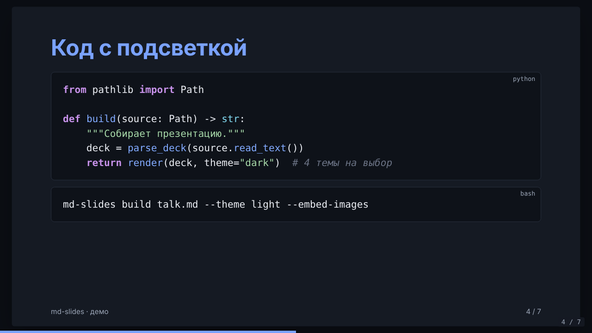
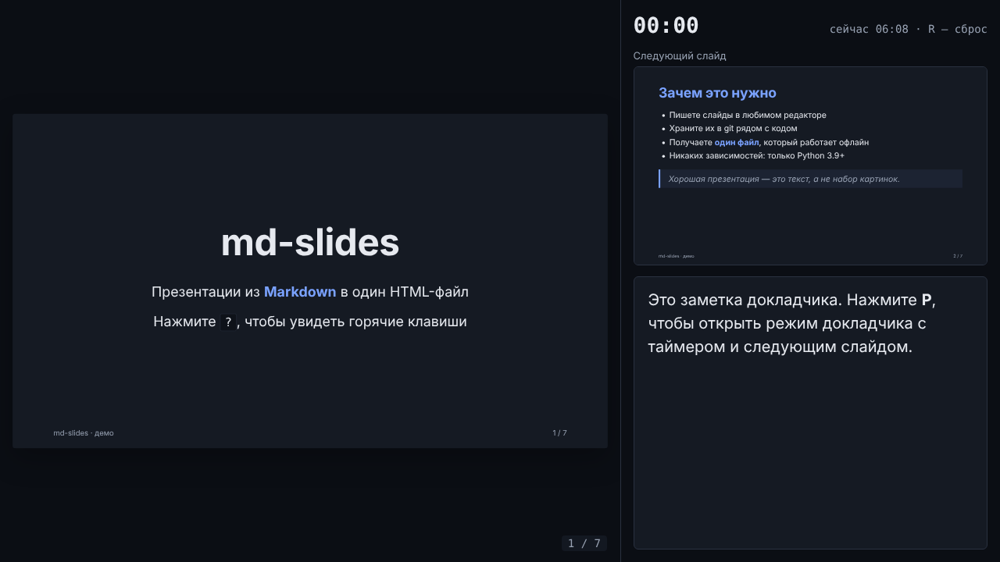

# md-slides

Генератор презентаций из **Markdown** в **один автономный HTML-файл**. Пишете слайды в любимом редакторе, храните их в git рядом с кодом и получаете страницу, которая открывается в любом браузере без интернета и без установки чего-либо.

Без внешних зависимостей: парсер Markdown, подсветка кода, сервер предпросмотра и интерфейс показа написаны с нуля на Python и чистом JavaScript.



## Возможности

- **Один файл:** CSS, JS и (по желанию) картинки встраиваются прямо в HTML.
- **Markdown:** заголовки, абзацы, списки (вложенные, нумерованные, чекбоксы), цитаты, таблицы с выравниванием, ссылки, картинки, `код`, **жирный**, *курсив*, ~~зачёркнутый~~.
- **Подсветка кода** для Python, JavaScript/TypeScript, Bash, CSS, HTML/XML и JSON.
- **4 темы:** `light`, `dark`, `terminal`, `sepia`. Во время показа тема переключается клавишей `T`.
- **Режим докладчика** (`P`): заметки, таймер, текущее время, превью следующего слайда.
- **Пошаговое появление** пунктов списка (директива `<!-- fragments -->`).
- **Навигация:** стрелки, пробел, свайпы, клики; переход по номеру или заголовку (`G`); обзор всех слайдов (`O`); ссылки вида `#5` на конкретный слайд.
- **Живой предпросмотр:** `md-slides serve` пересобирает презентацию при сохранении, и страница обновляется сама.
- **Режим `--watch`** для пересборки файла при изменениях.
- **PDF:** печать из браузера (`Ctrl+P` → «Сохранить как PDF»), каждый слайд на отдельной странице, все фрагменты раскрыты.
- **Соотношение сторон** 16:9, 4:3 или 16:10; нижний колонтитул и нумерация слайдов.
- **Безопасность:** «сырой» HTML экранируется, ссылки `javascript:` не создаются, значения директив проверяются.



## Установка

Нужен Python 3.9 или новее.

```bash
git clone https://github.com/mrsolo743-dot/md-slides.git
cd md-slides
pip install .            # команда md-slides появится в PATH
```

Можно обойтись без установки и запускать прямо из папки: `python -m md_slides …`.

## Быстрый старт

```bash
md-slides init talk.md          # пример презентации
md-slides serve talk.md --open  # предпросмотр на http://127.0.0.1:8000
md-slides build talk.md         # готовый talk.html рядом с исходником
```

## Команды

| Команда | Что делает |
|---|---|
| `md-slides build talk.md` | собирает `talk.html` |
| `  -o dist/index.html` | путь к результату |
| `  --theme dark` | тема: `light`, `dark`, `terminal`, `sepia` |
| `  --aspect 4:3` | соотношение сторон: `16:9`, `4:3`, `16:10` |
| `  --embed-images` | встроить локальные картинки (data: URI) |
| `  --watch` | пересобирать при каждом сохранении |
| `md-slides serve talk.md [-p 8000] [--open]` | предпросмотр с автообновлением |
| `md-slides init [talk.md] [--force]` | создать пример презентации |
| `md-slides outline talk.md` | список слайдов с отметками о заметках и директивах |
| `md-slides themes` | доступные темы и соотношения сторон |

## Формат файла

```markdown
---
title: Мой доклад
author: Тимур
theme: dark
aspect: 16:9
footer: Конференция 2026
paginate: true
---

# Первый слайд

Текст слайда

Note: заметка для докладчика (видна только в режиме P)

---

<!-- class: center -->
<!-- fragments -->
## Второй слайд
- появится первым
- появится вторым
```

- Слайды разделяются строкой `---`. Внутри блоков кода она игнорируется.
- Front matter (первый блок между `---`) необязателен. Ключи: `title`, `author`, `description`, `theme`, `aspect`, `footer`, `paginate`, `lang`.
- Заметки начинаются со строки `Note:` (или `Notes:`, `Заметки:`) и продолжаются до конца слайда.
- Директивы слайда:

| Директива | Пример | Эффект |
|---|---|---|
| `class` | `<!-- class: center title -->` | CSS-классы слайда (`center` — по центру, `title` — крупный заголовок) |
| `fragments` | `<!-- fragments -->` | пункты списков появляются по одному |
| `background` | `<!-- background: #1d3b8a -->` | фон слайда |
| `color` | `<!-- color: white -->` | цвет текста |
| `id` | `<!-- id: demo -->` | id слайда |

## Горячие клавиши

| Клавиши | Действие |
|---|---|
| `→` `Пробел` `PgDn` `Enter` | дальше |
| `←` `PgUp` `Backspace` | назад |
| `Home` / `End` | первый / последний слайд |
| `G` | перейти по номеру или части заголовка |
| `O` | обзор всех слайдов |
| `P` | режим докладчика, `R` — сброс таймера |
| `F` | полный экран |
| `T` | сменить тему |
| `B` | чёрный экран |
| `?` | подсказка |

## Пример вывода

```text
$ md-slides build examples/demo.md
✓ examples/demo.md → examples/demo.html (32 КБ)

$ md-slides outline examples/demo.md
md-slides — презентации из Markdown — слайдов: 7
  1. md-slides  [заметки; class=center title]
  2. Зачем это нужно
  3. Пошаговое появление  [заметки; fragments=true]
  4. Код с подсветкой
  5. Таблицы
  6. Списки задач
  7. Спасибо!  [class=center, background=#1d3b8a, color=#ffffff]
```

Готовое демо лежит в [`examples/demo.html`](examples/demo.html): скачайте файл и откройте в браузере.

## Тесты

```bash
pip install pytest
python -m pytest              # 101 тест: парсер, сборка, CLI, сервер, браузер
```

Браузерные тесты (`tests/test_browser.py`) проверяют навигацию, фрагменты, режим докладчика, обзор, темы и печать в настоящем Chromium. Без Playwright они пропускаются автоматически. Чтобы их включить:

```bash
pip install playwright
python -m playwright install chromium
```

## Структура проекта

```text
md-slides/
├── md_slides/
│   ├── __init__.py        # версия пакета
│   ├── __main__.py        # python -m md_slides
│   ├── cli.py             # команды build / serve / init / outline / themes
│   ├── deck.py            # front matter, деление на слайды, заметки, директивы
│   ├── markdown.py        # блочный парсер Markdown → HTML
│   ├── inline.py          # строчная разметка, экранирование, проверка ссылок
│   ├── highlight.py       # подсветка синтаксиса на регулярных выражениях
│   ├── render.py          # сборка автономной HTML-страницы
│   ├── server.py          # сервер предпросмотра с живой перезагрузкой
│   ├── watch.py           # отслеживание изменений файла
│   └── assets/
│       ├── template.html  # каркас страницы
│       ├── style.css      # темы, вёрстка слайдов, печать
│       ├── app.js         # навигация, фрагменты, докладчик, обзор
│       └── example.md     # шаблон для команды init
├── examples/              # демо-презентация (md и собранный html)
├── docs/                  # скриншоты для README
├── tests/                 # pytest + Playwright
├── pyproject.toml
├── LICENSE
└── README.md
```

## Лицензия

[MIT](LICENSE) © 2026 Тимур Иванов
